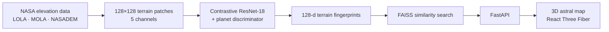

# ASTRAL — a planetary Shazam for Moon and Mars analogs

**NASA Space Apps Challenge 2026 · Team Dinamita Buena Onda**
Challenge: *Identify Earth Locations that Analog the Permanent Moon Base Locations and Mars*

> Pick a site on the Moon or Mars. ASTRAL's own neural network — trained by us on
> NASA elevation data, **not** an LLM API — finds its twins on Earth, scores how
> alike they are in terrain, operations, temperature and materials, and says
> honestly what Earth can never reproduce: gravity, vacuum and radiation.

## Why it matters

Astronauts train on Earth for places they have never been. NASA trained the Apollo
crews at **El Pinacate, Sonora (1965–1970)** because its volcanic terrain looked like
the Moon — a choice made by expert eyes. ASTRAL makes that search systematic: a
network that compares terrain across worlds and proposes **new** analog sites for the
Artemis south-pole bases and for Mars.

**Our test:** El Pinacate is hidden from training. If the network finds it on its own
when asked about lunar volcanic terrain, it is seeing what the Apollo planners saw.

## How it works

- **Self-supervised:** the network learns terrain similarity from augmented views of
  the same patch, with no hand labels.
- **Planet-blind:** a discriminator behind a gradient-reversal layer forces the
  embedding to forget *which world* a patch came from and keep *what the terrain is*.
- **Validated:** compared against a hand-crafted terrain-statistics baseline on known
  analogs (Meteor Crater, Atacama, Mauna Kea, Haughton, McMurdo Dry Valleys…), plus
  the El Pinacate blind test and an ablation without the discriminator.
- **Explainable:** Grad-CAM shows which part of the Earth terrain matched.

## Repository

| Folder | What | Team |
| --- | --- | --- |
| [`ml/`](ml/) | Patches, network, training, embeddings, validation | Esteban |
| [`backend/`](backend/) | FastAPI: similarity search and mission-profile scores | Angel, Tamara, Ethan |
| [`frontend/`](frontend/) | 3D globes, analog arcs, terrain galaxy, result cards | Hanna, Gris |
| [`docs/`](docs/) | Architecture and inter-module contracts (team docs, Spanish) | All |
| [`contracts/`](contracts/) | Example JSON for every API / artifact contract | All |

## Data sources

All data comes from the challenge's official portals:

- **Moon:** LRO LOLA polar DEM (60 m), NASA PDS Geosciences · LRO Diviner (temperature)
- **Mars:** MGS MOLA MEGDR (128 px/deg), NASA PDS Geosciences
- **Earth:** NASADEM (30 m) and MODIS MOD11C3 land-surface temperature, NASA Earthdata

A full list of datasets, libraries and third-party resources will be in the
references section before submission.
