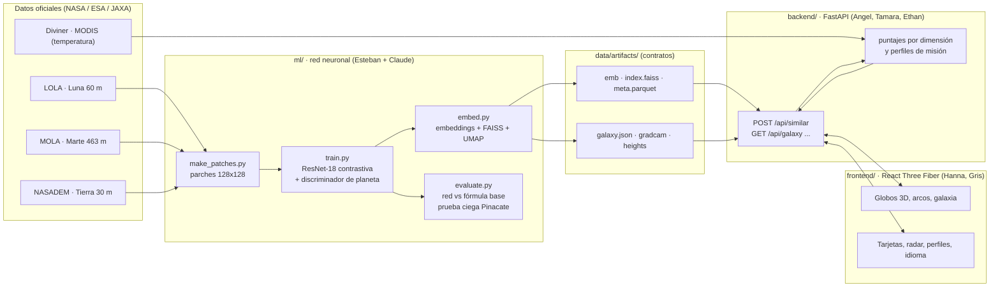

# Arquitectura de ASTRAL

## 1. La idea en una frase

Un usuario toca un punto en la Luna o en Marte → el backend toma el parche de relieve
de ese punto → la **red neuronal** ya convirtió cada parche (de los tres cuerpos) en
un vector de 128 números → el backend busca los vectores terrestres más parecidos →
el frontend dibuja los gemelos en el globo con su puntaje y su explicación.

## 2. Flujo de punta a punta

## 3. Responsabilidades

| Módulo | Entra | Sale | No hace |
| --- | --- | --- | --- |
| `ml/` | DEMs crudos de los portales oficiales | Artefactos de `docs/contratos.md` §1 | No sirve HTTP ni dibuja |
| `backend/` | Artefactos de ML + datos térmicos | JSON de `docs/contratos.md` §3 y §5 | No entrena ni modifica embeddings |
| `frontend/` | JSON y binarios de la API | La experiencia que ve el jurado | No calcula puntajes |

ML también puede modificar `backend/` (es el corazón del proyecto), siempre con el
protocolo de aviso del `CLAUDE.md` raíz §4.1.

## 4. Las dos escalas

| Escala | Compara | Ventana del parche |
| --- | --- | --- |
| 60 m/px | Luna con Tierra | 7.68 km |
| 500 m/px | Marte con Tierra | 64 km |

Cada escala tiene su propio índice (`index_60.faiss`, `index_500.faiss`). El backend
elige el índice según el cuerpo de la consulta.

## 5. Cómo trabajar en paralelo sin bloquearse

1. **Antes de H8:** frontend usa los ejemplos de `contracts/` como *mock*; backend
   arma los endpoints devolviendo esos mismos ejemplos.
2. **H10 a H12:** ML entrega los artefactos reales; backend cambia el *mock* por la
   búsqueda real en FAISS. **Si nadie cambió el contrato, el frontend no se entera.**
3. **H12:** búsqueda de punta a punta.

Por eso los contratos son sagrados: permiten que 6 personas avancen al mismo tiempo.
